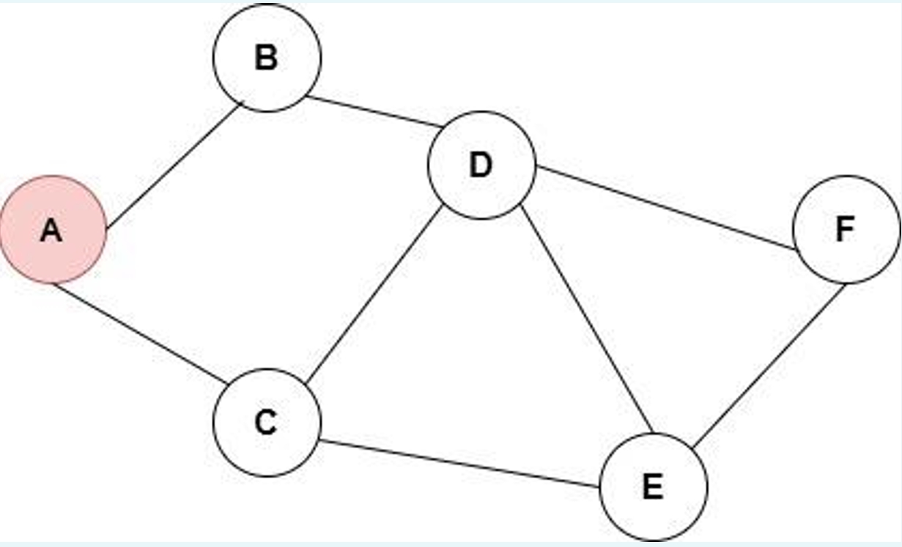

# Breadth-First Search in Synchronous Networks

**Bao Hoai LAM** - lhbao@ctu.edu.vn  
FSE - CICT

## 1. Synchronous Network

- An undirected graph $G = (V, E)$:
	- $n = |V|$
	- $Gamma(u)$: set of neighbors of vertex $u$
	- $d(u) = |Gamma(u)|$: number of neighbors of vertex $u$
- A vertex corresponds to a process.
- An edge corresponds to 2 directed channels.

## 2. Network Execution

- An algorithm executes in synchronous rounds.
- In each round, a process:
	- Maintains a local state.
	- Sends messages to output ports.
	- Receives messages from input ports.
	- Computes a new state.
- An edge corresponds to 2 directed channels (output and input).
- Cost metrics:
	- Ignore local computation cost.
	- Time: number of rounds.
	- Communication: number of messages.

## 3. Leader

- One process is elected as a leader.
- The leader is responsible for:
	- Communication
	- Data coordination
	- Scheduling

## 4. BFS(start)

- Mark process `start`.
- At process $i$ in round $j$:
	- If process $i$ plans to send, it sends a probing message to its neighbors.
	- If process $i$ is not marked and it receives messages:
		- Mark it.
		- Output its state.
		- Plan to send in the next round.
